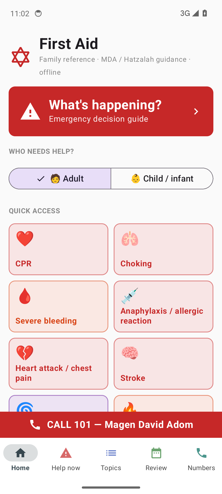
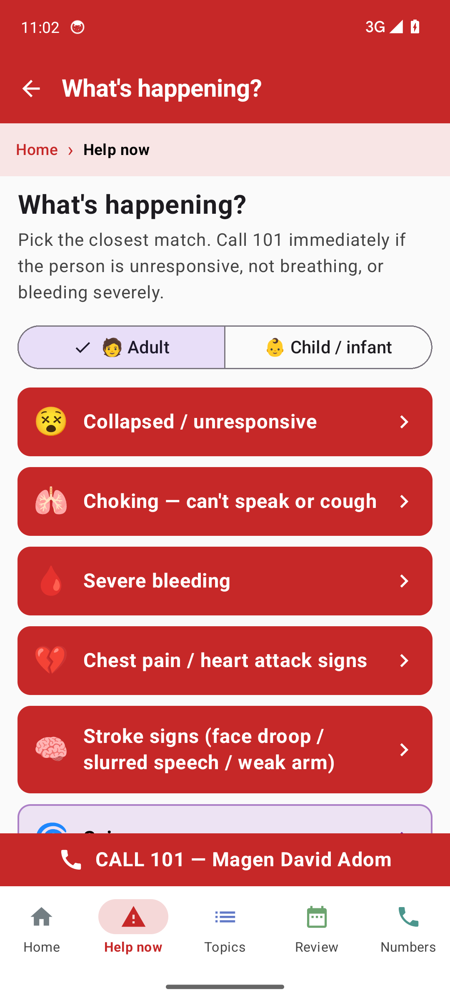
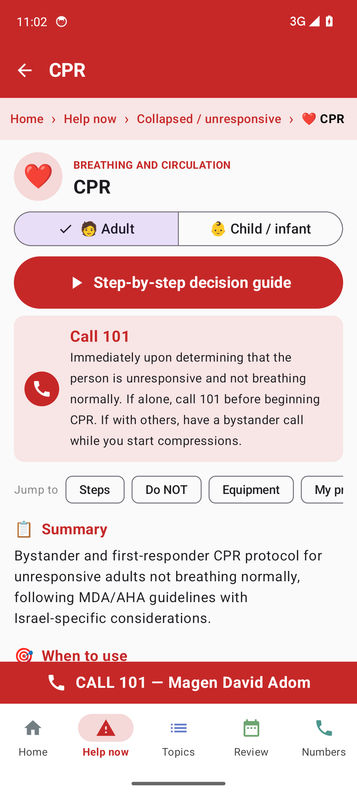
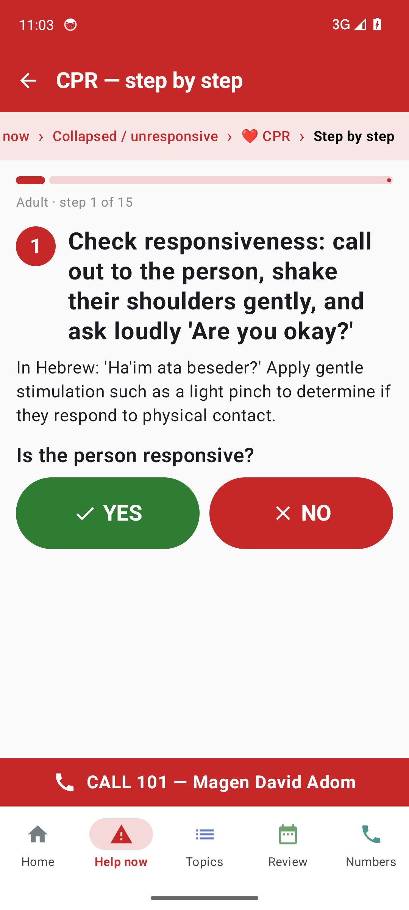
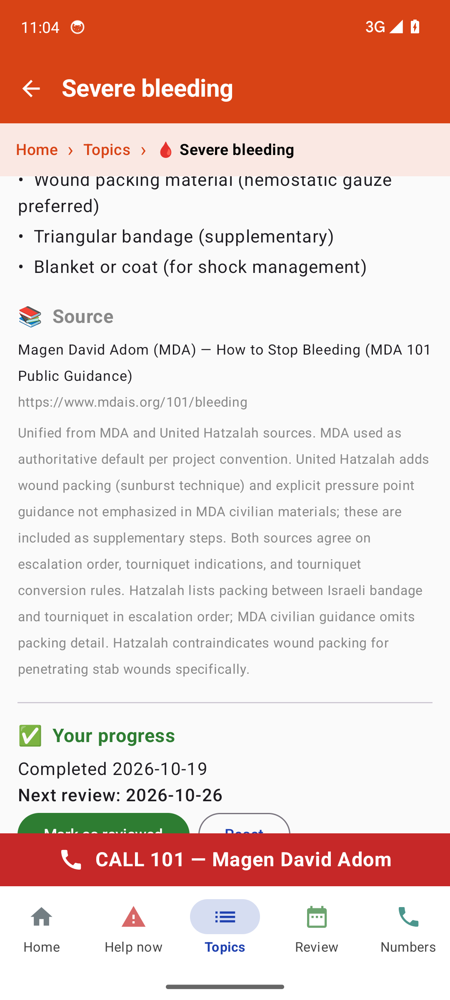
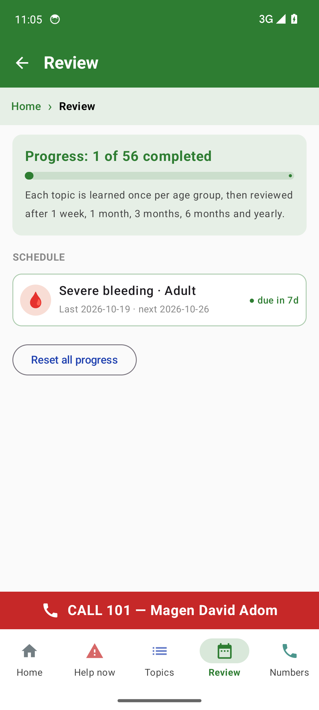
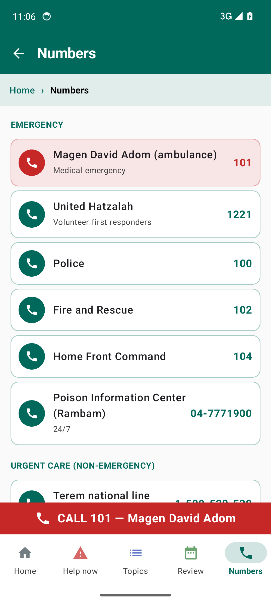

# Family First Aid (Android)

An offline Android first-aid app for families in Israel, grounded in
**Magen David Adom** and **United Hatzalah** guidance. It covers adults and children,
lets you walk through each protocol as a decision flowchart, and keeps a
**spaced review** schedule so the material stays fresh. A book on a shelf does none of that.

> **Not medical advice.** A personal study and reference aid, not an official MDA,
> Hatzalah or Ministry of Health product. It does not replace first-aid training.
> **In an emergency, call 101.**

<p>
       
</p>

<sub>Screenshots are from the CI emulator smoke test (<code>scripts/smoke-test.sh</code>), which taps through these screens on every push.</sub>

## Install

Download the latest `family-first-aid-*.apk` from
[Releases](../../releases/latest), open it on your phone, and allow "Install unknown
apps" when prompted. New versions are new releases: install the new APK over the old
one. Your review progress is kept.

## What's in it

| Strand | What it does |
|---|---|
| **Material** | 28 topics × adult and child = 56 protocols, grouped by type of emergency (breathing and circulation, bleeding and trauma, medical, environment, bites and stings). Each has a summary, when to use it, steps, "do not" list, equipment and source. |
| **Decision flows** | *What's happening?* is a standalone triage tree that routes to a protocol. Every protocol also has a **step-by-step** mode: one step on screen at a time, big YES/NO buttons at each decision point, and jumps to the step that the answer points to. |
| **Spaced review** | Mark a topic completed for adult and/or child, then *mark as reviewed* when due. Intervals: 1 week → 1 month → 3 months → 6 months → yearly. The app shows a progress bar, a due list and the review dates, and has a reset. Progress is stored on the device only. |
| **Crisis UI** | A "CALL 101" bar and a colour-coded section bar (Home · Help now · Topics · Review · Numbers) are pinned to every screen, with breadcrumbs under the title to jump back up the path. Home has one-tap tiles for the most urgent protocols, and the adult / child choice is made once and carried everywhere. Each topic group has its own colour and every topic an icon. The launcher icon is a red Star of David. A numbers page has click-to-dial for MDA, Hatzalah, police, fire, Home Front Command, the poison center, Terem (national line and Jerusalem branches) and the Maccabi Moked. |

The app has no internet permission, so everything works offline.

## Forking for another country or organisation

The idea is meant to be forked. All content is data in `app/src/main/assets/`:

- `protocols/{adult,child}/<topic>.json`: one protocol per file, schema in `docs/protocol-schema.json`.
- `topics.json`: topic grouping, display names, group `color`, per-topic `icons` (emoji) and the `quick` list of home-screen tiles.
- `triage.json`: the *What's happening?* tree (nodes → answers → `goto` / `category` / `call`). An answer that `goto`s another node can carry an `icon`; answers that open a topic use the topic's icon.
- `contacts.json`: click-to-dial numbers.

To make your own version, replace those files, change `"101"` in `EmergencyBar` (`MainActivity.kt`) and `DISCLAIMER` (`Screens.kt`), replace the star in `res/drawable/ic_launcher_foreground.xml`, change `applicationId`, and push.

## Building

The APK is built by GitHub Actions (`.github/workflows/build.yml`). You don't need an Android SDK on your own machine.

- Every push to `main` builds the APK as a workflow artifact.
- Pushing a tag `vX.Y.Z` builds it and publishes a GitHub Release with the APK attached.
- Release signing uses repo secrets `SIGNING_KEYSTORE_B64`, `SIGNING_STORE_PASSWORD`, `SIGNING_KEY_ALIAS`, `SIGNING_KEY_PASSWORD`. Without them the build falls back to the debug key. An APK signed that way **cannot be installed over** a release-signed one.

Locally with an SDK installed: `./gradlew assembleRelease`.

Stack: Kotlin, Jetpack Compose (Material 3), no other libraries. minSdk 26.

## Repository layout

```
app/                     Android app (Kotlin + Compose); content in app/src/main/assets/
idea/                    The originating voice note (MP3) and its transcript
docs/prior-art.md        What existed before this repo (own and external)
docs/illustration-style-guide.md   Rules for the (planned) AI-generated illustrations
docs/protocol-schema.json          JSON Schema for protocol files
reference/israel/        Per-source research notes (MDA / Hatzalah) behind each protocol
reference/kit/           First-aid kit shopping and stock-check lists
print/                   Printable Typst/PDF flowcharts
```

## Roadmap

- **Phase 1 (this release)**: offline app, decision flows, spaced review.
- **Illustrations**: generate instructional images per `docs/illustration-style-guide.md`.
- **Review reminders**: a local notification when a review falls due.
- **Phase 2**: sign in with Google and sync review history to Drive, so two parents share one schedule. `ReviewStore.exportJson()` is the payload.
- Hebrew UI.

## History

This repository consolidates and replaces earlier first-aid repos (`Israel-First-Aid`,
`Israel-First-Aid-App`, `First-Aid-Curriculum`). See `docs/prior-art.md`.
